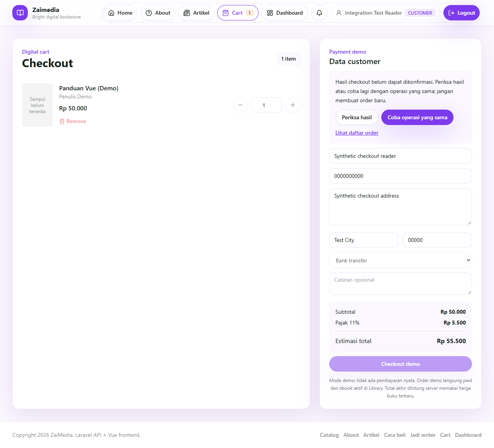

# Zaimedia

Alur Vue, autentikasi API, checkout, akses PDF dan dashboard dijelaskan di [CODE_FLOW](docs/CODE_FLOW.md).

Aplikasi toko buku digital dengan **Laravel 13 / PHP 8.3+** sebagai API dan **Vue 3 / Vite 8 / Tailwind CSS** sebagai frontend. Katalog, artikel, keranjang, perpustakaan PDF, dan dashboard customer, writer, admin, serta super_admin tersedia dalam satu aplikasi.

Checkout belum terhubung ke payment gateway. Mode normal membuat order **pending**. Mode demo dapat mensimulasikan order paid, tanpa memindahkan uang sungguhan.

Checkout memakai identitas operasi per akun agar respons yang hilang dapat diperiksa atau dikirim ulang dengan kunci yang sama. Cart dan formulir dikunci saat pengiriman. Bila hasil belum jelas, gunakan kontrol pemulihan di halaman checkout. Rincian retry, penyimpanan tab dan batas pemulihannya ada di [kontrak checkout](docs/CHECKOUT_PROTOCOL.md).

## Cuplikan checkout

Tampilan Chrome dari stack MySQL dengan akun dan buku sintetis dalam mode demo. Pada gambar ini, respons sengaja diputus setelah server menyimpan order; pengguna dapat memeriksa hasil atau mencoba operasi yang sama.



Jika order sudah tersimpan tetapi cart lokal belum berhasil dibersihkan, UI menawarkan pembersihan lokal tanpa membuat order lain. Lihat [tampilan konfirmasi lokal](docs/images/checkout-confirmed-local.png) dan [tampilan pada viewport 640 px](docs/images/checkout-640.png). Tidak ada pembayaran nyata pada cuplikan ini.

## Menjalankan dengan Docker

Siapkan Docker Desktop dengan Linux containers, Git, dan Python 3. Jalankan dari folder repository:

```sh
git clone https://github.com/zalamanga/zaimedia.git
cd zaimedia
python scripts/setup-local.py
docker compose up -d --build
docker compose ps
```

Buka **http://127.0.0.1:18090**. Endpoint pemeriksaan API: `/api/health`.

Script setup membuat `.env` privat berisi APP_KEY dan password database acak. Ia menolak menimpa file yang sudah ada. Simpan file ini untuk penggunaan berikutnya; mengganti password `.env` saja tidak mengganti password database pada volume yang sudah dibuat. `.env` tidak ikut Git maupun build image.

Compose menjalankan tiga service:

| Service | Tugas |
| --- | --- |
| `web` | nginx, hasil build Vue, routing SPA, `/api`, dan gambar upload publik. Hanya service ini yang membuka port host, pada loopback `127.0.0.1`. |
| `app` | PHP-FPM dan Laravel API; menjalankan migration dan menambahkan pengaturan awal yang belum ada saat container dimulai. |
| `db` | MySQL 8.4 pada jaringan internal Docker. |

Database baru dibuat dari migration. **Jangan import SQL instalasi lama ke skema ini.** Ini bukan alat migrasi akun, transaksi, atau buku dari aplikasi PHP lama. Instalasi awal menambahkan pengaturan dasar tanpa membuat akun atau buku. Pengaturan yang sudah tersimpan dipertahankan saat restart.

Untuk mengganti port pada instalasi baru, gunakan `python scripts/setup-local.py --port 18091`. Pada `.env` yang sudah ada, sesuaikan `APP_PORT` dan `APP_URL` bersamaan sebelum membuat ulang container.

```sh
docker compose logs --tail=100 app web
docker compose down
```

`down` menghentikan container dan mempertahankan volume `db-data`, `app-storage`, serta `uploads`. Cadangkan volume dan `.env` sebelum mengganti instalasi. Opsi `down -v` menghapus data volume.

## Membuat admin

Buat akun dengan identitas sendiri. Command berikut meminta password tersembunyi, minimal 8 karakter:

```sh
docker compose exec app php artisan zaimedia:create-admin --username=admin_lokal --email=admin@example.test --name="Admin Lokal"
```

Role bawaan adalah `super_admin`; tambahkan `--role=admin` untuk admin biasa. Command tidak menimpa akun yang sudah ada. Untuk otomasi, command membaca password dari environment `ZAIMEDIA_ADMIN_PASSWORD` dan menerima `--no-interaction`; jangan menaruh password di source atau argumen password CLI. Detail backend ada di [laravel-api/README.md](laravel-api/README.md).

Registrasi publik selalu membuat customer. Customer dapat mengajukan akses writer dari dashboard untuk ditinjau admin.

## Demo opsional

Untuk instalasi demo baru, ganti langkah setup dengan:

```sh
python scripts/setup-local.py --demo
docker compose up -d --build
```

Jika `.env` sudah ada, script tetap mempertahankannya. Aktifkan `CHECKOUT_DEMO_MODE=true` dan `CHECKOUT_AUTO_PAID=true` secara sengaja, lalu jalankan ulang Compose. Auto-paid hanya bekerja pada environment `local` atau `testing`, kedua flag tersebut aktif, dan pengaturan database `checkout_auto_paid` tidak dimatikan.

Data sintetis dapat ditambahkan dengan `DemoSeeder`. Seeder membutuhkan password pilihan sendiri melalui `ZAIMEDIA_DEMO_PASSWORD`, minimal 8 karakter. Contoh PowerShell berikut membaca password tanpa menampilkannya:

```powershell
$demoSecret = Read-Host 'Password akun demo (minimal 8 karakter)' -AsSecureString
$env:ZAIMEDIA_DEMO_PASSWORD = [System.Net.NetworkCredential]::new('', $demoSecret).Password
docker compose exec -e ZAIMEDIA_DEMO_PASSWORD app php artisan db:seed --class=DemoSeeder
Remove-Item Env:ZAIMEDIA_DEMO_PASSWORD
```

Seeder membuat akun `demo_customer`, `demo_other_customer`, `demo_writer`, `demo_admin`, dan `demo_super_admin`, dengan email `<username>@example.test`. Ia juga membuat dua buku/PDF sintetis, artikel, serta order `DEMO-PAID` dan `DEMO-PENDING`. Tidak ada password bawaan. Menjalankannya lagi mempertahankan akun yang sudah ada, termasuk passwordnya.

Status pembayaran, refund, royalti, dan withdrawal di aplikasi hanya mencatat data lokal. Tidak ada proses transfer, penagihan kartu, atau pengembalian uang nyata. Frontend menampilkan status dari server dan mengambil estimasi pajak melalui `/api/storefront-config`.

## PDF dan penyimpanan

PDF berada di `laravel-api/storage/app/private/books/pdf`, bukan folder publik. Katalog hanya menampilkan `has_pdf`; nama dan URL file PDF tidak dibuka ke publik.

Reader mengambil `GET /api/library/{id}` dan `GET /api/library/{id}/download` dengan **Bearer token**, lalu menampilkan Blob URL. Akses diperiksa untuk pembeli dengan order paid, pemilik writer, atau admin. Order pending tidak membuka akses PDF. Cover, avatar, dan gambar artikel tetap dilayani melalui `/uploads`.

nginx menyediakan fallback SPA agar refresh pada `/books/...`, `/articles/...`, dan `/dashboard` tetap membuka frontend. Jangan memetakan storage privat sebagai direktori web.

## Struktur dan pengembangan

```text
laravel-api/       API, migration, seeder, command admin, dan tes PHP
vue-frontend/      Source Vue, komponen, router, dan tes state
docker/            nginx, PHP-FPM, entrypoint, dan healthcheck
scripts/           Setup environment lokal
tests/             Tes API dan browser terintegrasi
Dockerfile         Build frontend dan image aplikasi
compose.yaml       Stack lokal tiga service
```

Frontend lokal membutuhkan Node **20.19+ atau 22.12+** dan npm. Node 22 digunakan pada Docker. Untuk membangun frontend tanpa Docker:

```sh
npm --prefix vue-frontend ci
npm --prefix vue-frontend run build
```

`npm --prefix vue-frontend run dev` membuka Vite pada port 5174. Proxy development saat ini mengarah ke backend lokal `http://localhost:8010` untuk `/api` dan `/uploads`; siapkan backend tersebut atau sesuaikan target proxy. Docker tidak memerlukan Vite dev server, PHP, Composer, atau MySQL terpasang pada host.

## Pemeriksaan

Verifikasi 22 Oktober 2026: 18 tes backend (140 assertion), 13 tes unit frontend, dan 30 kasus API/browser Chrome lulus. Sesudah koreksi warna label menu mobile, satu kasus writer diperiksa ulang. Docker juga diuji dengan MySQL kosong, upload PDF 50 MiB, serta persistensi database, pengaturan, APP_KEY dan berkas setelah restart.

Pembaruan checkout pada 26 Oktober 2026 diperiksa dengan **25 tes PHP (199 assertion)**, **31 tes unit frontend**, dan **18 pemeriksaan normalisasi PHP/JavaScript**. Pada MySQL 8.4.11, tiga POST bersamaan dengan kunci/data yang sama menghasilkan satu order; replay, konflik data, receipt milik akun sendiri, parser JSON asli dan mode pending juga diperiksa. Runtime native memakai PHP 8.3.36. Suite SQLite memakai PHP 8.5.12 dan mencatat satu deprecation dari konstanta PDO pada konfigurasi lama, tanpa kegagalan tes.

Bukti browser dipisahkan menurut perubahan: 30 kasus API/browser lama lulus sebelum koreksi parser dan tampilan terakhir. Setelahnya, satu kasus konkurensi native dan 11 kasus Chrome checkout lulus. Perapian layout terakhir diperiksa lagi melalui lima kasus fokus, termasuk judul panjang/quantity 10 pada viewport 320/390/640/1280 dan ukuran teks CSS 100%/200%. Pemeriksaan ukuran teks ini tidak mensimulasikan seluruh perilaku zoom browser.

Tes frontend menggunakan Node, storage palsu, dan adapter API mock; tidak menghubungi database:

```sh
npm --prefix vue-frontend test
```

Vector normalisasi dapat diperiksa tanpa dependency Laravel:

```sh
php -n laravel-api/tests/checkout-intent.php
```

Tes backend dapat dijalankan melalui container:

```sh
docker compose exec app php vendor/bin/phpunit --do-not-cache-result
```

Atau dengan dependency backend terpasang dan PHP 8.3+ yang memiliki SQLite:

```sh
cd laravel-api
composer test
```

`phpunit.xml` memaksa environment testing dan SQLite `:memory:`. Guard tes menolak koneksi database lain. Tes memakai data sintetis dan fake storage.

Tes Playwright di root melakukan login, registrasi, checkout, dan pemeriksaan browser/API. Gunakan **stack dan volume uji terpisah**, misalnya project Compose `zaimedia-codex-check-20261022`, port 18090, serta `DemoSeeder`. Jangan arahkan suite ini ke instalasi berisi data pribadi.

Suite mensyaratkan environment `ZAIMEDIA_TEST_FIXTURE_FILE` yang menunjuk JSON privat di luar repository:

```json
{
  "project": "zaimedia-codex-check-20261022",
  "baseURL": "http://127.0.0.1:18090",
  "allowMutations": true,
  "password": "GANTI_DENGAN_PASSWORD_DEMO_PRIVAT"
}
```

Isi `password` dengan password `DemoSeeder` pada database uji. Jangan commit fixture. Guard menolak origin selain HTTP loopback port 18090 atau fixture yang tidak cocok. Browser memblokir request keluar dari origin pengujian.

```powershell
npm ci
$env:ZAIMEDIA_TEST_FIXTURE_FILE = 'D:\ZaimediaTest\fixture.json'
npm run test:list
npm run test:browser
Remove-Item Env:ZAIMEDIA_TEST_FIXTURE_FILE
```

Windows memakai Google Chrome yang terpasang secara default. Pilih channel lain melalui `PLAYWRIGHT_CHANNEL` bila diperlukan. Pada Linux, pasang browser yang sesuai dengan `npx playwright install chromium`. Pada mesin pemeriksaan, Edge 155 mengembalikan respons PDF kosong pada fetch/XHR, sedangkan Chrome 155 menerima PDF dan membuka reader; gunakan Chrome bila menemui gejala tersebut. Hasil tes dan file sementara berada di cache project dan tidak ikut Git. Perintah di atas adalah cara menjalankan pemeriksaan, bukan klaim bahwa seluruh suite sudah lulus pada setiap mesin.

Audit dependency produksi frontend tidak menemukan vulnerability pada pemeriksaan 22 Oktober 2026. Audit lengkap masih memiliki tujuh entri pada tooling dev Tailwind 3: [braces belum memiliki patched release](https://github.com/advisories/GHSA-vfj7-8cjw-p6xm), dan [perbaikan selector-parser membutuhkan major 7](https://github.com/advisories/GHSA-rj75-hqrm-r3gf). Temuan menyangkut pemrosesan glob/CSS tak tepercaya pada build atau watch; tooling Node tersebut tidak dibawa ke image runtime. Tailwind 3 dipertahankan agar pembaruan ini tidak mengubah seluruh pipeline CSS.

## Sumber lama

Working tree ini menggunakan Laravel API + Vue. Aplikasi PHP lama, dump database, upload pribadi, dan cadangan lokal disimpan terpisah di luar repository kerja, bukan digabungkan ke runtime baru.

Commit lama repository pernah berisi ZIP dan SQL. **Riwayat Git dan bundle cadangan masih dapat memuat berkas tersebut**; perapian working tree ini tidak menghapusnya dari seluruh riwayat. Jangan menggunakan cadangan lama sebagai fixture tes atau menganggap data lama sudah dipurge dari GitHub.
