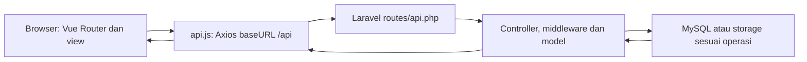
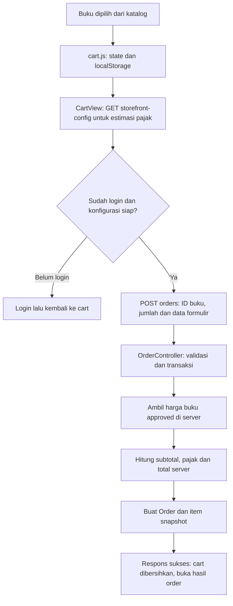
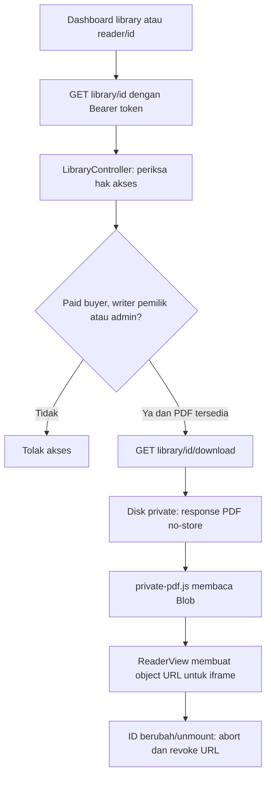

# Alur Zaimedia Laravel API + Vue

## Batas frontend dan backend

[vue-frontend/src/main.ts](../vue-frontend/src/main.ts) memasang App.vue dan Vue Router. [router.js](../vue-frontend/src/router.js) mengatur katalog /, detail /books/:id, artikel, /cart, /login, /reader/:id, hasil order dan /dashboard. Guard frontend mengarahkan halaman privat ke login ketika tidak mempunyai sesi lokal; keputusan akses sebenarnya tetap dilakukan API.

[docker/nginx.conf](../docker/nginx.conf) menyajikan hasil build Vue dengan fallback index.html untuk refresh rute SPA. Request /api diteruskan ke front controller Laravel/PHP-FPM. /uploads hanya menyajikan gambar publik; penyimpanan PDF privat tidak dipetakan menjadi direktori web.

[laravel-api/routes/api.php](../laravel-api/routes/api.php) adalah sumber endpoint. GET katalog/kategori/artikel dan konfigurasi storefront bersifat publik. Auth/me, order, library, writer dan admin berada di middleware auth:sanctum serta active.user, dengan pembatasan role pada kelompok rute terkait. Implementasi ini terpisah dari aplikasi PHP lama dan tidak mengimpor akun, order atau upload lamanya.

## Sesi dan otorisasi

[auth.js](../vue-frontend/src/auth.js) mengirim login/register melalui [api.js](../vue-frontend/src/api.js), lalu menyimpan user/token di state Vue dan localStorage melalui [storage.js](../vue-frontend/src/storage.js). Password bukan isi sesi tersimpan. Interceptor menambahkan Bearer token pada request API. Respons 401 atau akun yang dinonaktifkan menghapus sesi lokal; App menangani pemberitahuan/login ulang. Logout mencoba mencabut token server dan tetap membersihkan state lokal bila jaringan gagal.

[AuthController](../laravel-api/app/Http/Controllers/Api/AuthController.php) memvalidasi input, membuat hash password dan menerbitkan token Sanctum. Registrasi memaksa role customer/status active; login tidak menerima akun nonaktif. [EnsureActiveUser](../laravel-api/app/Http/Middleware/EnsureActiveUser.php) dan [EnsureRole](../laravel-api/app/Http/Middleware/EnsureRole.php) mengendalikan endpoint privat. super_admin diizinkan ketika kelompok role mencakup admin. Mengubah localStorage atau tampilan menu bukan pemberian role server.

## Katalog, cart dan order

[HomeView.vue](../vue-frontend/src/views/HomeView.vue) mengambil /books dengan filter/pagination serta data kategori/populer/terbaru. [BookController](../laravel-api/app/Http/Controllers/Api/BookController.php) membatasi katalog/detail publik ke buku approved. Model [Book](../laravel-api/app/Models/Book.php) menyembunyikan pdf_file dalam JSON dan menambahkan has_pdf/cover_url.

[cart.js](../vue-frontend/src/cart.js) menyimpan pilihan pada localStorage key zaimedia_cart_vue. [state-utils.js](../vue-frontend/src/state-utils.js) menormalisasi ID/harga/jumlah, menggabungkan buku ganda dan membatasi jumlah 1–10. Angka harga pada browser merupakan estimasi, bukan harga final yang dipercaya server.

[CartView.vue](../vue-frontend/src/views/CartView.vue) tidak mengirim harga cart sebagai sumber tagihan. [OrderController](../laravel-api/app/Http/Controllers/Api/OrderController.php) menggabungkan ID ganda, membatasi qty, menolak buku yang tidak tersedia dan pembelian buku sendiri. Pajak memakai SystemSetting server; shipping_cost saat ini nol walaupun form mempertahankan data/metode alamat sumber.

[Checkout::autoPaid](../laravel-api/app/Support/Checkout.php) hanya aktif pada local/testing dengan kedua flag demo dan pengaturan database yang mengizinkan. Selain itu order dimulai pending. Tidak ada payment gateway/transfer nyata. [OrderSuccessView.vue](../vue-frontend/src/views/OrderSuccessView.vue) menampilkan hasil/status dari API, bukan menganggap semua order sudah lunas.

Admin dapat mencatat perubahan status lokal melalui controller yang sama. Row order dikunci; transisi paid menjalankan [OrderLedger](../laravel-api/app/Support/OrderLedger.php) untuk catatan penjualan/royalti sekali. Refund mengurangi royalti dan menghapus ledger penjualan dalam transaksi; saldo yang sudah dialokasikan untuk withdrawal dapat membuatnya ditolak. Semua ini pencatatan lokal, bukan pengiriman atau pengembalian uang bank.

## Library dan PDF privat

[LibraryController](../laravel-api/app/Http/Controllers/Api/LibraryController.php) memeriksa order paid, pemilik writer atau admin, termasuk record buku yang diarsipkan. Order pending tidak membuka PDF. [ReaderView.vue](../vue-frontend/src/views/ReaderView.vue) dan [private-pdf.js](../vue-frontend/src/private-pdf.js) mengambil Blob melalui API berotorisasi, bukan menyusun URL publik dari nama file. PDF yang gagal dimuat mempunyai retry; object URL lama dilepas saat reader berpindah/dilepas.

[UploadStorage](../laravel-api/app/Support/UploadStorage.php) memisahkan disk private untuk PDF dan uploads untuk gambar. Nama baru dicatat sebagai upload akun tersebut dan referensi buku/artikel divalidasi terhadap kepemilikannya. File buku yang masih dirujuk, termasuk arsip, tidak dihapus hanya karena satu record diganti. Kontrak upload/PDF lebih rinci ada di [README API](../laravel-api/README.md).

## Dashboard menurut role

[DashboardView.vue](../vue-frontend/src/views/DashboardView.vue) memuat summary/kategori, kemudian data sesuai role. Tab disinkronkan dengan query tab; createRequestGate dari state-utils menolak respons lama mengubah state tampilan yang lebih baru.

| Role | Kelompok alur |
| --- | --- |
| Customer | Order sendiri, library paid, wishlist, profil, pengajuan writer |
| Writer | Buku milik sendiri/upload/arsip, penjualan, royalti/withdrawal, serta order/library pribadi |
| Admin/super_admin | Review buku, kategori, akun/role/status, order, withdrawal, artikel, review, pengajuan writer, setting, audit dan ekspor |

Tombol dashboard memakai endpoint yang tercantum di routes/api.php; middleware/controller memeriksa role dan kepemilikan meski tab disembunyikan di frontend. [RoyaltyController](../laravel-api/app/Http/Controllers/Api/RoyaltyController.php) mengunci saldo/withdrawal saat memindahkan saldo lokal; completed/rejected merupakan status akhir. Profile/password dan admin audit merupakan alur API, bukan penyimpanan formulir statis.

## Pemeriksaan yang tersedia

[vue-frontend/tests/state.test.js](../vue-frontend/tests/state.test.js) memeriksa state/storage/gate menggunakan mock. [laravel-api/tests/Feature](../laravel-api/tests/Feature) mencakup auth, role, upload/PDF dan alur admin. [tests/api.spec.js](../tests/api.spec.js) serta [tests/browser.spec.js](../tests/browser.spec.js) memakai stack/fixture uji yang dijaga, sesuai [README](../README.md). Dokumen ini disusun dari pembacaan source saja; tidak menjalankan aplikasi, memakai kredensial/database privat atau mengubah frontend/backend.
